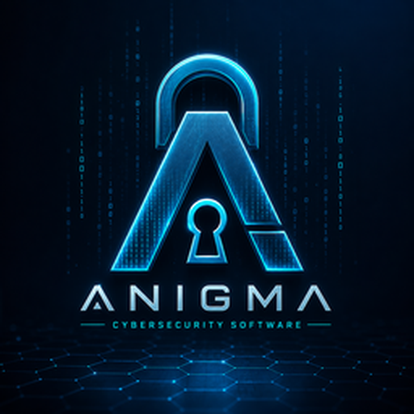
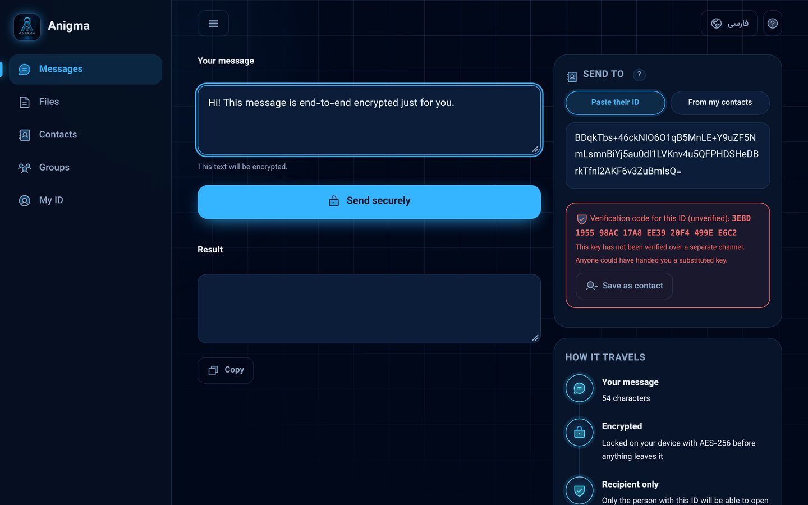
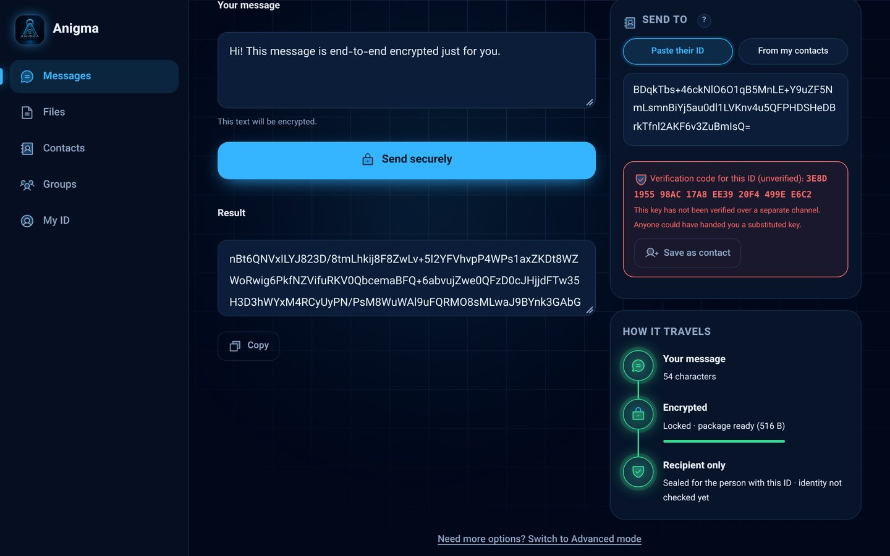
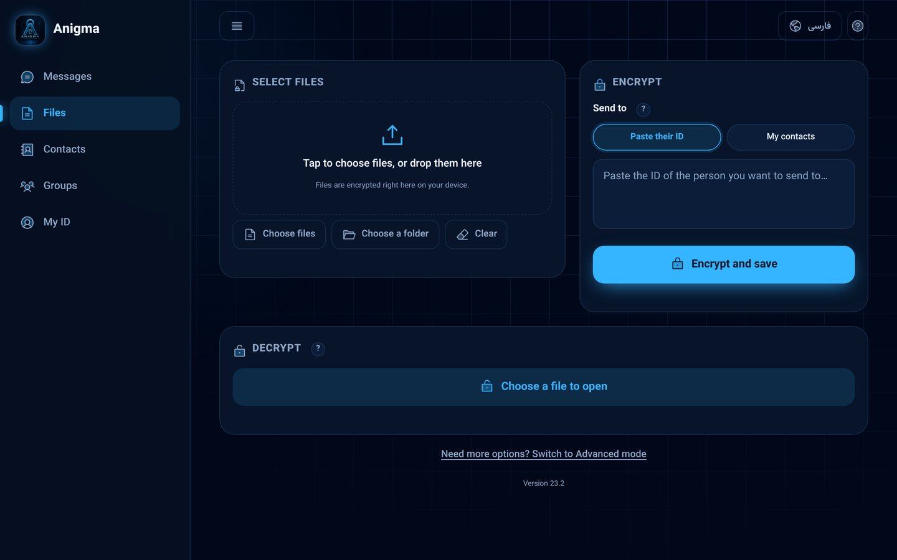
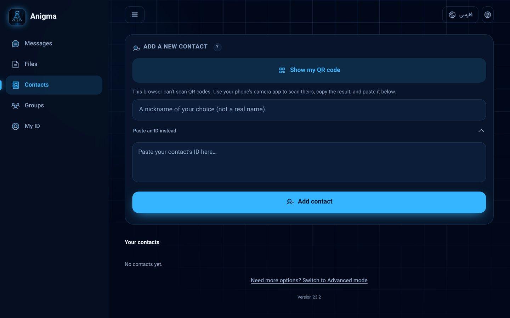
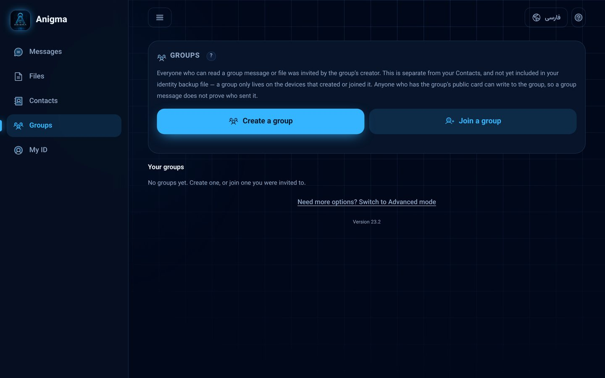
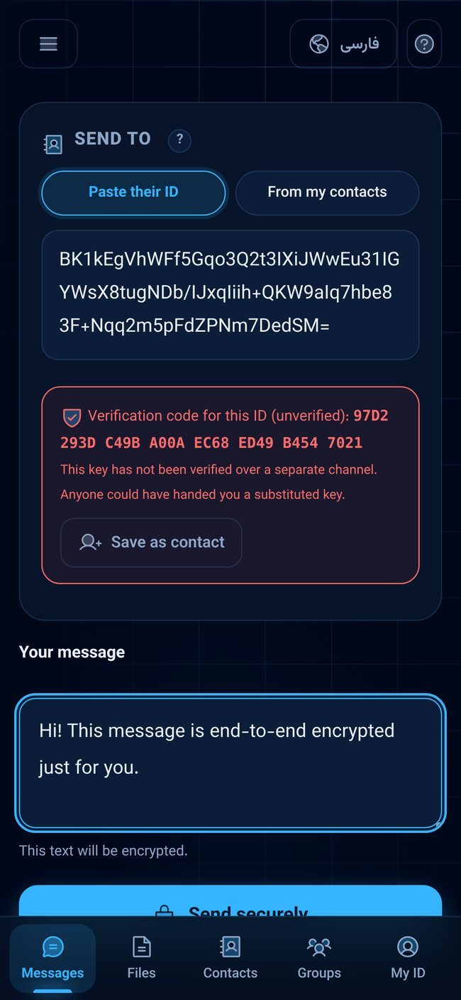
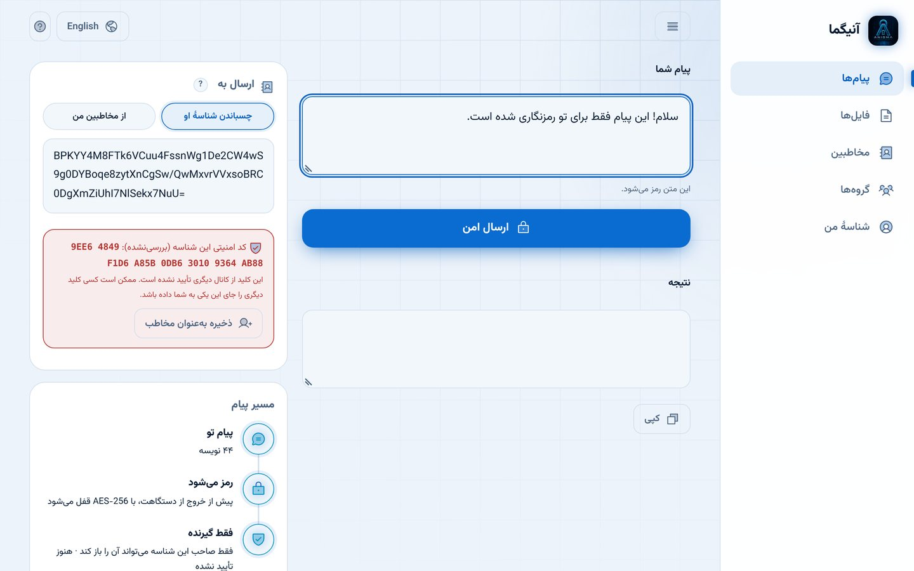

# Anigma · آنیگما

### Your words. Your keys. Your privacy.
### حرف‌های شما، کلیدهای شما، حریم خصوصی شما.

  
  
  

  
  
  
  

<a href="#english">🇬🇧 English</a> &nbsp;·&nbsp; <a href="#persian">🇮🇷 فارسی</a> &nbsp;·&nbsp; <a href="../../releases">⬇️ Download / دانلود</a>

---

## Screenshots · نمایی از محیط برنامه

Explore the real Anigma interface across desktop and mobile.  
تصاویر واقعی از محیط آنیگما در نسخه‌های دسکتاپ و موبایل.

<table>
  <tr>
    <td align="center" width="50%">
      
      <strong>Secure messaging · پیام امن</strong>
    </td>
    <td align="center" width="50%">
      
      <strong>Encrypted result · نتیجه رمزگذاری</strong>
    </td>
  </tr>
  <tr>
    <td align="center">
      
      <strong>Files · فایل‌ها</strong>
    </td>
    <td align="center">
      
      <strong>Contacts · مخاطبین</strong>
    </td>
  </tr>
  <tr>
    <td align="center">
      
      <strong>Groups · گروه‌ها</strong>
    </td>
    <td align="center">
      
      <strong>Mobile · نسخه موبایل</strong>
    </td>
  </tr>
  <tr>
    <td align="center" colspan="2">
      
       
      <strong>Persian interface · رابط فارسی</strong>
    </td>
  </tr>
</table>

## English

### What is Anigma?
Anigma is a free app that keeps your messages and files private. You write something, Anigma locks it with the key of the person you choose, and only that person can open it. You can then send it through **any** channel you like — a messenger, email, SMS, a USB stick or a printed QR code — and it stays protected the whole way.

Everything happens **on your own device**. There is no account to create, no server holding your data, and no tracking. Your keys are born on your device and stay there.

### Why we built it
Anigma was created with a humanitarian purpose: **to protect the privacy and safety of everyday people.** Privacy is a basic human right. Journalists, aid workers, students, families, patients and anyone who simply values their personal space should be able to communicate with confidence — in their own language, on whatever device they have, even with a slow or closely watched connection. Strong protection should feel simple, and Anigma is designed to make it so.

### Highlights
| | |
|---|---|
| 🔒 **End-to-end encryption** | Messages and files are locked with modern, authenticated cryptography (AES-GCM, ECDH P-256, optional X25519). |
| 🧠 **Strong password protection** | Your identity is guarded by a memory-hard function (Argon2id). |
| 📴 **Offline-first** | Works without internet once installed. Nothing is uploaded. |
| 📷 **QR contacts** | Add people by scanning a QR code and confirm them with a short verification code. |
| 👥 **Encrypted groups** | Share with several people and remove members when needed. |
| 💾 **Encrypted backup** | Back up your identity in a file only you can open. |
| 🌐 **Two languages** | Full فارسی and English interface, with right-to-left support. |
| 🎛️ **Simple & Advanced modes** | Easy for everyday use, with extra controls for experts. |
| 📱💻 **Works everywhere** | Android, Windows, and any modern browser on phone, tablet or computer. |
| ✅ **Trusted updates** | The app only accepts update notices carrying a valid digital signature. |

### Download
Get the newest version from the **[Releases](../../releases)** page.

| Platform | File | Notes |
|---|---|---|
| 📱 Android | `Anigma.apk` | If asked, allow “install from this source”. |
| 💻 Windows | `Anigma-Setup.exe` | If Windows shows a SmartScreen notice, choose *More info → Run anyway* after checking the checksum below. |

> 💡 **Tip:** Each release lists a SHA-256 checksum. Comparing it with your downloaded file is a quick way to be sure it is exactly the file we published.

### Your privacy at a glance
- ✅ Everything is processed locally on your device.
- ✅ No account, no ads, no analytics, no personal data collection.
- ✅ Built on your platform's own trusted cryptography (Web Crypto API).
- ℹ️ The app occasionally checks GitHub for signed update information. Like any web request, GitHub can see an IP address when this happens.

### Tips for the best experience
- Choose a long, unique password — a few random words work well.
- Keep your device and the app up to date.
- Save an encrypted backup of your identity somewhere safe.

### Terms of use
Anigma is provided in good faith to help protect people's privacy and is provided "as is." The developers assume no responsibility for any illegal or unethical use of the program. Ordinary users who use Anigma to protect their privacy have no reason to worry

---

## فارسی

### آنیگما چیست؟
آنیگما یک برنامهٔ رایگان برای خصوصی نگه داشتن پیام‌ها و فایل‌های شماست. شما چیزی می‌نویسید، آنیگما آن را با کلیدِ همان کسی که انتخاب کرده‌اید قفل می‌کند و فقط او می‌تواند بازش کند. بعد آن را از **هر مسیری** که دوست دارید می‌فرستید — پیام‌رسان، ایمیل، پیامک، فلش یا QR چاپ‌شده — و در تمام مسیر محافظت‌شده می‌ماند.

همه‌چیز **روی دستگاه خودتان** انجام می‌شود. نیازی به ساخت حساب نیست، سروری داده‌های شما را نگه نمی‌دارد و ردیابی‌ای وجود ندارد. کلیدهای شما روی دستگاه خودتان ساخته می‌شوند و همان‌جا می‌مانند.

### چرا ساختیم؟
آنیگما با هدفی **بشردوستانه** ساخته شده است: **حفاظت از حریم خصوصی و امنیت مردم عادی.** حریم خصوصی یک حق اساسی انسان است. روزنامه‌نگاران، امدادگران، دانشجویان، خانواده‌ها، بیماران و هر کسی که برای فضای شخصی‌اش ارزش قائل است باید بتواند با اطمینان ارتباط برقرار کند — به زبان خودش، روی هر دستگاهی که دارد، حتی با اینترنت کند یا تحت نظارت. محافظت قوی باید ساده باشد و آنیگما برای همین ساخته شده است.

### ویژگی‌های برجسته
| | |
|---|---|
| 🔒 **رمزنگاری سرتاسری** | پیام‌ها و فایل‌ها با رمزنگاری مدرن و احرازهویت‌شده (AES-GCM، ECDH P-256 و در صورت انتخاب X25519) قفل می‌شوند. |
| 🧠 **محافظت قوی با رمز عبور** | هویت شما با تابع حافظه‌سخت Argon2id محافظت می‌شود. |
| 📴 **کار آفلاین** | پس از نصب بدون اینترنت کار می‌کند و چیزی آپلود نمی‌شود. |
| 📷 **مخاطب با QR** | با اسکن QR مخاطب اضافه کنید و با یک کد تأیید کوتاه مطمئن شوید. |
| 👥 **گروه‌های رمزگذاری‌شده** | با چند نفر هم‌زمان به‌اشتراک بگذارید و هر وقت لازم شد عضو را حذف کنید. |
| 💾 **پشتیبان رمزگذاری‌شده** | از هویت خود در فایلی نسخهٔ پشتیبان بگیرید که فقط خودتان بازش می‌کنید. |
| 🌐 **دو زبانه** | رابط کامل فارسی و انگلیسی با پشتیبانی راست‌به‌چپ. |
| 🎛️ **حالت ساده و پیشرفته** | برای استفادهٔ روزمره ساده است و برای متخصصان گزینه‌های بیشتری دارد. |
| 📱💻 **اجرا در همه‌جا** | اندروید، ویندوز و هر مرورگر مدرن روی موبایل، تبلت یا کامپیوتر. |
| ✅ **به‌روزرسانی مطمئن** | برنامه فقط اعلان‌های به‌روزرسانی با امضای دیجیتال معتبر را می‌پذیرد. |

### دانلود
جدیدترین نسخه را از صفحهٔ **[Releases](../../releases)** بگیرید.

| سیستم‌عامل | فایل | توضیح |
|---|---|---|
| 📱 اندروید | `Anigma.apk` | اگر خواست، «نصب از این منبع» را مجاز کنید. |
| 💻 ویندوز | `Anigma-Setup.exe` | اگر ویندوز پیام SmartScreen نشان داد، پس از بررسی checksum گزینهٔ *More info ← Run anyway* را بزنید. |

> 💡 **نکته:** هر release یک checksum از نوع SHA-256 دارد. مقایسهٔ آن با فایل دانلودشده راه سریعی است تا مطمئن شوید دقیقاً همان فایلی است که منتشر کرده‌ایم.

### حریم خصوصی شما در یک نگاه
- ✅ همهٔ پردازش‌ها روی دستگاه خودتان انجام می‌شود.
- ✅ بدون حساب کاربری، بدون تبلیغات، بدون آمارگیری و بدون جمع‌آوری اطلاعات شخصی.
- ✅ بر پایهٔ رمزنگاری قابل‌اعتمادِ خودِ سیستم‌عامل (Web Crypto API) ساخته شده است.
- ℹ️ برنامه گاهی اطلاعات امضاشدهٔ به‌روزرسانی را از گیت‌هاب بررسی می‌کند. مثل هر درخواست وب، گیت‌هاب در این لحظه آدرس IP را می‌بیند.

### توصیه‌هایی برای بهترین تجربه
- رمز عبور بلند و یکتا انتخاب کنید؛ چند کلمهٔ تصادفی انتخاب خوبی است.
- دستگاه و برنامه را به‌روز نگه دارید.
- یک نسخهٔ پشتیبان رمزگذاری‌شده از هویت خود را در جای امنی نگه دارید.

### شرایط استفاده
آنیگما با حسن‌نیت و برای کمک به حفاظت از حریم خصوصی مردم ارائه شده و «همان‌گونه که هست» عرضه می‌شود. سازندگان هیچ مسئولیتی در قبال استفادهٔ غیرقانونی یا غیراخلاقی از برنامه نمی‌پذیرند. کاربران عادی که برای حفاظت از حریم خصوصی خود از آنیگما استفاده می‌کنند جای هیچ نگرانی ندارند.

---

## License & permissions

Anigma is free to download and use under the [Anigma Personal Use License](LICENSE). You may download it from the official Anigma repository or its Releases page and use an unmodified copy for personal purposes. Redistribution, mirroring, republishing, modifying, or distributing modified versions requires prior written permission from the rights holder. Third-party components remain subject to their own licenses. This license does not revoke rights already granted for earlier versions distributed under a previous license.

### Security reports & contact

For security concerns, vulnerability reports, or official inquiries, contact: **anigmamodern@gmail.com**. Please report suspected vulnerabilities privately and avoid posting exploitable details publicly.

## مجوز و شرایط استفاده

آنیگما تحت [مجوز اختصاصی استفادهٔ شخصی Anigma](LICENSE) ارائه می‌شود و دانلود و استفاده از نسخهٔ بدون تغییر آن رایگان است. دانلود باید از مخزن رسمی Anigma یا بخش Releases انجام شود. بازنشر، آینه‌سازی، انتشار مجدد، ویرایش برنامه یا توزیع نسخه‌های تغییر‌یافته بدون اجازهٔ کتبی صاحب حقوق مجاز نیست. اجزای شخص ثالث همچنان تابع مجوزهای مستقل خود هستند. این مجوز حقوقی را که برای نسخه‌های قدیمی‌تر تحت مجوز قبلی اعطا شده، لغو نمی‌کند.

### گزارش امنیتی و ارتباط رسمی

برای گزارش مشکلات امنیتی، آسیب‌پذیری‌ها یا مکاتبات رسمی با پروژه Anigma از این ایمیل استفاده کنید: **anigmamodern@gmail.com**. لطفاً جزئیات آسیب‌پذیری‌های احتمالی را به‌صورت خصوصی ارسال کنید و اطلاعات قابل سوءاستفاده را به‌صورت عمومی منتشر نکنید.

